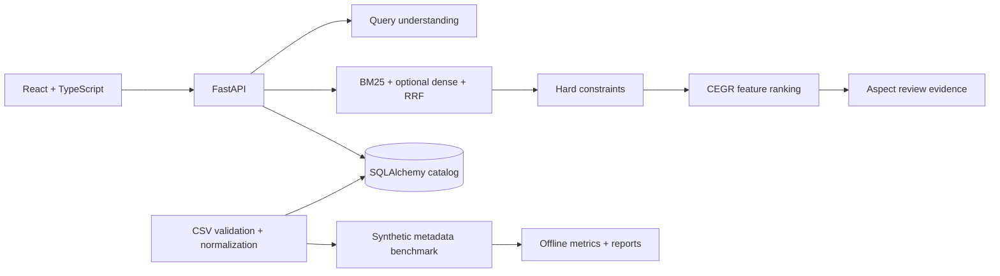

# AisleIQ

**Evidence-Grounded Product Discovery and Constraint-Aware Ranking**

AisleIQ is an offline research prototype for turning a natural-language shopping request into catalog candidates that respect known constraints and expose the review text behind attribute claims. It is an independent project using a publicly available historical review dataset; it does not reproduce Flipkart’s private search, ranking systems, or internal data.

## What it does

- Parses product category, use case, price ceilings/floors, aliases, and simple preference/negation cues.
- Retrieves with BM25; optionally adds CPU sentence-transformer vectors and reciprocal rank fusion (RRF). Without the optional model, the API explicitly reports BM25-only fallback.
- Applies known budget/category hard filters before CEGR soft ranking.
- Extracts simple review aspects and polarity, aggregates evidence, and returns verbatim excerpts with source review IDs.
- Reports missing evidence, a heuristic confidence indicator, and uncertainty; returns no results when known hard filters exclude every candidate.
- Includes product detail, comparison, explain/search, and system metrics endpoints plus a React interface.

## Architecture



See [system architecture](docs/architecture/system_architecture.md), [data flow](docs/architecture/data_flow.md), and [architecture decisions](docs/architecture/architecture_decisions.md).

## Dataset and limits

The public Kaggle archive contains `Dataset-SA.csv`. The retrieved copy has **205,052 rows**, **958 distinct product names**, six columns, and **34,375 exact duplicate rows**. Its sentiment labels are positive 166,581, negative 28,232, neutral 10,239. Kaggle’s description says 205,053 rows and 104 products; those counts differ from the actual downloaded file. Raw data is ignored by Git.

The linked Q2P survey describes 7,500 queries and 22,500 pairs, but the public PDF provides no download link, data availability statement, repository, schema or access process. The data could not be verified or obtained, so AisleIQ does not use or claim it. The included queries are **synthetic templates generated from actual product titles, prices and review text**, split by product ID; they are not customer queries.

Read the [dataset research record](docs/research/dataset_research.md) and [dataset card](docs/datasets/review_dataset_card.md) before interpreting results.

## Measured benchmark (local machine)

The test split contains 428 synthetic queries and one weak positive source-product association per query. On this narrow title/metadata task:

| Method | Recall@5 | Recall@10 | MRR@10 | nDCG@3 | nDCG@10 | Constraint violation | Mean total ms |
|---|---:|---:|---:|---:|---:|---:|---:|
| BM25 | 1.000 | 1.000 | 0.994 | 0.996 | 0.996 | 0.130 | 5.11 |
| Dense | 1.000 | 1.000 | 0.994 | 0.995 | 0.995 | 0.135 | 4.78 |
| Hybrid (BM25 + dense + RRF) | 1.000 | 1.000 | 0.993 | 0.995 | 0.995 | 0.135 | 5.33 |
| CEGR hard filters + evidence score | 0.960 | 0.960 | 0.946 | 0.950 | 0.950 | 0.000 | 25.89 |
| CEGR + LambdaMART | 0.960 | 0.960 | 0.958 | 0.959 | 0.959 | 0.000 | 23.92 |

The title-derived task strongly favors lexical retrieval and is not evidence of customer relevance. CEGR removes measured known constraint violations, with lower reciprocal rank and higher latency. The LambdaMART model was trained on synthetic weak labels, selected at validation iteration 1, and remains below BM25 MRR. These are honest but narrow results. Reports include ablations, category breakdowns, evidence coverage, index time and local memory measurements: [benchmark results](reports/benchmark_results.md), [ablation study](reports/ablation_study.md), [error analysis](reports/error_analysis.md), and [generated metrics](reports/generated/).

Hardware: AMD Ryzen 5 5500U with Radeon Graphics, 6 cores / 12 logical threads, Windows 11, Python 3.14.0, 7.87 GB reported RAM. Index build (including CPU embedding) took 99.36 s; process RSS after indexing was 217.5 MB; mean total CEGR request path was 25.89 ms and p95 was 83.86 ms. These are local single-process measurements, not Flipkart-scale estimates. Confidence is an evidence and score-margin heuristic, not a calibrated probability. The LambdaMART model is deliberately labeled weakly supervised and trained from synthetic product metadata only.

## Run locally

Requirements: Python 3.11+, Node.js 20+, npm. Windows, macOS and Linux are supported.

```bash
python -m venv .venv
# Windows PowerShell: .venv\Scripts\Activate.ps1
# macOS/Linux: source .venv/bin/activate
pip install -e ".[semantic,ranker,dev]"
python scripts/download_data.py
python scripts/validate_data.py
python scripts/build_dataset.py
python scripts/generate_benchmark.py
python scripts/train_ranker.py
python scripts/run_experiments.py
uvicorn aisleiq.api:app --reload
```

In another terminal:

```bash
cd frontend
npm install
npm run dev
```

Open http://localhost:5173. API docs are at http://localhost:8000/docs. The retrieval catalog is built from the source dataset; without the data preparation steps, the API reports that the catalog is not ready.

### Optional semantic retrieval

```bash
pip install -e ".[semantic,dev]"
```

The first API startup with these extras may download `sentence-transformers/all-MiniLM-L6-v2` from Hugging Face. Embedding weights are cached outside the repository. FAISS is used when available; otherwise dense cosine search uses NumPy. The checked-in 4.8 KB LambdaMART model is loaded if LightGBM is installed. Without these extras, search falls back to BM25 and reports that fact.

## Docker

Download and build the normalized catalog on the host first, then run:

```bash
python scripts/download_data.py
python scripts/build_dataset.py
docker compose up --build
```

The API is at http://localhost:8000 and the Vite UI at http://localhost:5173. The Compose UI container runs the Vite development server; this is a local development setup, not a production web deployment.

## API examples

```bash
curl -X POST http://localhost:8000/api/v1/search \
  -H "Content-Type: application/json" \
  -d '{"query":"gaming laptop under 80000 with good battery life","limit":5}'
```

```bash
curl http://localhost:8000/api/v1/products?page=1\&page_size=10
curl http://localhost:8000/api/v1/products/PRODUCT_ID
curl -X POST http://localhost:8000/api/v1/compare -H "Content-Type: application/json" -d '["ID_1","ID_2"]'
curl http://localhost:8000/api/v1/metrics
```

Search responses include parsed intent, retrieval mode, ranked products, matched attributes, constraint status, source reviews, pros/cons, rationale, confidence and uncertainty. `/api/v1/recommendations/explain` accepts the same body as search.

## Reproducibility and tests

```bash
pytest -q
python -m compileall -q aisleiq scripts
ruff check aisleiq scripts tests
cd frontend
npm test
npm run build
```

The CI workflow runs Python checks/tests and a TypeScript/Vite build. Benchmark outputs are regenerated from scripts and include their configuration. No raw dataset or model weights belong in Git.

## Key technical decisions

- RRF merges rank positions rather than incomparable BM25/cosine score magnitudes.
- Hard constraints precede preference scoring.
- Source excerpts are verbatim and retain source IDs; aspect and sentiment assignment remain heuristic.
- Confidence decreases with sparse evidence but is not calibrated.
- A LambdaMART model is included only as a weak-supervision experiment on synthetic metadata labels; it is not trained on genuine customer relevance or engagement data.
- SQLite supports local setup; `DATABASE_URL` supports SQLAlchemy database URLs. The dataset size does not justify Redis or microservices.

## Further reading

- [Research: industry problem](docs/research/industry_problem.md)
- [Research: related work](docs/research/related_work.md)
- [Dataset card](docs/datasets/review_dataset_card.md)
- [Model card](docs/models/model_card.md)
- [Interview preparation](docs/interview_prep.md)
- [Experiment configuration](reports/experiment_config.yaml)

## Known limitations

The source catalog is historical, scraped data with noisy labels and title-derived categories. It has no genuine user queries, query-product judgments, product descriptions/specifications, click logs, purchases or user personalization. The synthetic benchmark has high lexical overlap. Aspect and polarity rules can misread negation, sarcasm and multilingual text. Confidence is not calibrated. The semantic model was unavailable in the measured run. The frontend uses restrained category glyphs instead of product imagery because the source file contains no images. Results do not represent live Flipkart products or system performance.
