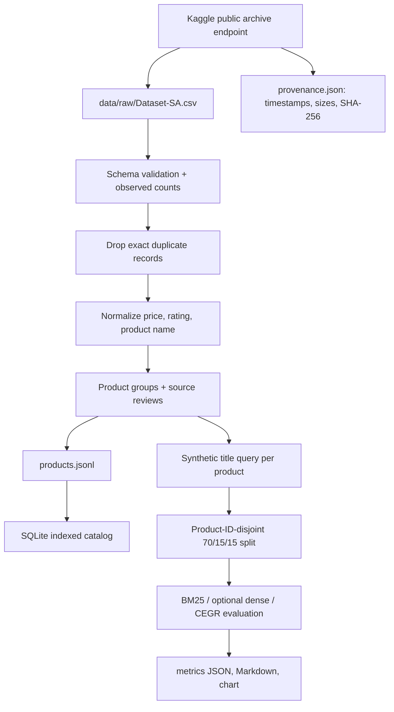

# Data flow

Raw data is local and ignored by Git. The source `Sentiment` label is preserved as supplied and not silently treated as human-verified truth. Missing review text is skipped while retaining products; missing prices are represented as null. Titles are grouped case-insensitively only through the source group operation after exact string grouping; IDs hash normalized lower-case titles, so casing-only variations may need review. Review IDs are deterministic for the resulting grouped row order. The manifest records pre-deduplication source stats and output counts.
