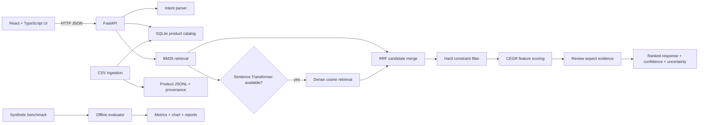

# System architecture

The application is a modular monolith. API, catalog access, query parsing, retrieval, ranking, review analysis and evaluation are separate Python modules in one deployable process. SQLite is the default development catalog; PostgreSQL URLs are accepted by SQLAlchemy for deployment. Redis and independently deployed services are omitted because the checked-in dataset and local workload do not justify additional operations.

## Runtime path

1. Startup reads normalized JSONL output and upserts it into the configured SQLAlchemy catalog, then constructs the retrieval index once.
2. A search request is validated by Pydantic. Intent parsing extracts category, budget bounds, use case and named aspects.
3. BM25 retrieves lexical candidates. If the optional sentence-transformers model is installed and its weights are available, normalized sentence embeddings provide a second ranked list. RRF merges the channels; otherwise the API announces lexical-only fallback.
4. CEGR removes candidates whose prices violate (or cannot verify) hard budget bounds, and whose catalog category is unknown or conflicts with the requested category. Missing prices are disclosed in the response notices.
5. A transparent weighted feature score uses retrieval rank, catalog text aspect matches and review aspect evidence. Supporting review objects are the actual source text and carry source IDs.
6. A heuristic confidence score is reduced when evidence is missing. It is not calibrated and is not advertised as a probability.

## Operational boundaries

The model is optional and local; it is not downloaded automatically at API startup. Database indexes cover product title/category and category-price. An in-process 256-entry LRU caches identical search requests. Request IDs and processing time are returned as headers. `/health` distinguishes process health from catalog readiness. OpenAPI is generated by FastAPI at `/docs`.
